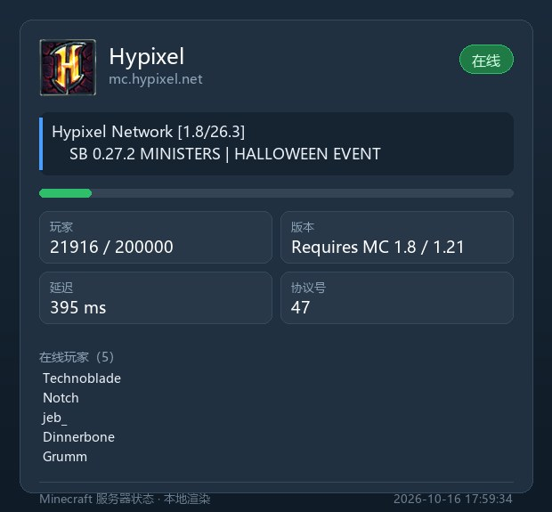
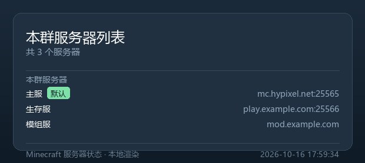

<div align="center">

# astrbot_plugin_minecraft_status

**在群聊里查 Minecraft 服务器状态 —— 本地直连，毫秒级出图。**

[](https://github.com/AstrBotDevs/AstrBot)
[](https://www.python.org/)
[](LICENSE)
[](#-测试)
[](#-它是怎么工作的)
[](#-性能为什么它很快)

不依赖任何第三方 API，不调用外部渲染服务。每个群聊的服务器数据互相隔离，
支持纯文字或精美卡片两种输出。

<a href="samples/preview-online.jpg"></a>

<sub>本地渲染 · 约 5ms/张 · 含服务器图标、MOTD、玩家进度与延迟</sub>

</div>

---

## ✨ 功能

| 指令 | 说明 |
| :--- | :--- |
| `/mc` | 查询本群**默认**服务器（未设置时给出友好提示） |
| `/mc <名称>` | 查询指定服务器 |
| `/mc add <名称> <IP/域名:端口>` | 添加服务器，**端口留空自动用 25565** |
| `/mc delete <名称>` | 删除服务器 |
| `/mc set <名称>` | 设置为默认服务器 |
| `/mc list` | 列出本群添加的所有服务器 |
| `/mc help` | 显示帮助 |

> 别名：`delete`／`del`／`remove`／`rm`；`list`／`ls`；`help`／`?`

**核心特性**

- 🔒 **群聊数据隔离** —— 以 `group:<群号>` 为键，私聊按 `private:<会话ID>` 隔离，各群互不可见
- ⭐ **默认服务器** —— 首个添加的自动成为默认；删除默认项时自动顺延到下一个
- 🖼️ **双输出模式** —— 纯文字，或渲染成卡片图（失败自动回退文字）
- ⚡ **本地渲染，约 5ms/张** —— 内置 Pillow 渲染器，不联网、不注入多余资源
- 🧱 **本地直连 SLP 协议** —— 不依赖任何第三方 API，数据准确、无隐私外泄
- 🛡️ **健壮** —— 旧版协议回退、IPv6、SRV 解析、颜色代码清理、异常全部兜底

## 🚀 快速开始

### 1. 安装插件

**方式一：从 Git 仓库安装（推荐）**

在 AstrBot WebUI 的 **插件管理 → 安装插件 → 输入仓库地址**，填入本仓库地址即可。

**方式二：从文件安装**

下载 [最新 Release](https://github.com/Celraw/astrbot_plugin_minecraft_status/releases/latest)
中的 `astrbot_plugin_minecraft_status.zip`，在 **插件管理 → 安装插件 → 从文件安装** 中选择它。

**方式三：手动放置**

把本仓库文件放入 AstrBot 的 `data/plugins/astrbot_plugin_minecraft_status/`，然后重载插件。

### 2. 添加并查询

```
/mc add 主服 mc.example.com            # 端口默认 25565，并自动设为默认
/mc add 副服 play.example.com:25566    # 指定端口
/mc                                    # 查询默认服务器
/mc 副服                                # 查询指定服务器
/mc list                               # 查看本群所有服务器
/mc set 副服                            # 把「副服」设为默认
/mc delete 主服                         # 删除
```

### 3. 依赖

插件本体只用标准库；图片渲染依赖 `Pillow`（**AstrBot 已自带**）。
可选：`pip install dnspython` 以启用 DNS SRV 记录解析。

## ⚙️ 配置

在 WebUI 的插件配置页面修改：

| 配置项 | 类型 | 默认 | 说明 |
| :--- | :--- | :--- | :--- |
| `output_mode` | string | `text` | `text` 纯文字；`image` 渲染成图片 |
| `render_engine` | string | `local` | `local` 本地渲染（约 5ms，推荐）；`html` 用 AstrBot 文转图服务 |
| `query_timeout` | int | `5` | 单服务器查询超时（秒） |
| `max_servers_per_session` | int | `10` | 每个会话可添加的服务器上限 |
| `show_player_list` | bool | `true` | 是否显示在线玩家名单 |
| `allow_srv_lookup` | bool | `true` | 是否启用 DNS SRV 解析 |

## 🖼️ 效果预览

<div align="center">

<table>
<tr>
<td align="center" width="50%">
<a href="samples/preview-list.jpg"></a><br>
<sub><b>/mc list</b> —— 服务器列表，标出默认项</sub>
</td>
<td align="center" width="50%">
<a href="samples/preview-offline.jpg"></a><br>
<sub><b>离线</b> —— 明确指出失败原因</sub>
</td>
</tr>
</table>

</div>

## ⚡ 性能：为什么它很快

AstrBot 自带的文转图是**网络渲染**，一次典型调用要经历：上传模板 → 远端无头浏览器渲染 →
返回图片 URL → 平台**再下载一次**图片。其中有两处明显浪费：

| 问题 | 实测影响 |
| :--- | :--- |
| AstrBot 会向模板注入约 **1.2 MB** 的 Shiki 代码高亮运行时 | 卡片模板本身仅约 7 KB，POST 体积被撑到约 **1.43 MB（215 倍）** |
| 返回 URL 后平台还要再下载一次 | 多一次完整网络往返 |

本插件默认改用**本地渲染**（`renderer_local.py`，Pillow 直接绘制）：
不联网、不注入 Shiki、没有第二次下载，**实测约 5 ms/张**，比网络渲染快 2–3 个数量级；
渲染在**线程池**中执行，不阻塞事件循环。

若你偏好 HTML 卡片样式，可将 `render_engine` 设为 `html`；此时插件仍会：

- 要求渲染服务**直接返回图片文件**（`return_url=False`），省掉下载往返；
- 借助模板顶部的标记让 AstrBot **跳过 Shiki 注入**（该卡片不含代码块）。

> 即使该内部标记未来失效，也只会退化为「较慢」，不影响正确性。

## 🔧 它是怎么工作的

```
/mc add 主服 mc.example.com
        │
        ├─ commands.py      解析子指令与地址（端口默认 25565）
        ├─ store.py         按群号写入 AstrBot 插件 KV 存储（群间隔离）
        │
/mc
        │
        ├─ store.py         取出本群默认服务器
        ├─ mc_protocol.py   本地直连 SLP：
        │                     Handshake(0x00) → Status Request(0x00)
        │                     → Status Response ← Ping(0x01) → Pong
        │                   现代协议失败时自动回退旧版 0xFE 0x01
        ├─ formatter.py     整理文本 / 模板数据
        └─ renderer_local.py Pillow 绘制卡片（约 5ms）
```

<details>
<summary><b>为什么用「平铺」仓库结构？</b></summary>

AstrBot 通过 Git 地址安装时，要求 `metadata.yaml`、`main.py` 位于**仓库根目录**，
因此本仓库采用社区通行的平铺布局（所有插件文件直接在根目录）。
打包 zip 时则由 `package.py` 自动包进 `astrbot_plugin_minecraft_status/` 顶层目录，
以兼容「从文件安装」流程。

</details>

<details>
<summary><b>实测的健壮性覆盖</b></summary>

- 现代协议失败 → 自动尝试旧版（≤1.6）协议
- IPv6 地址（`[2001:db8::1]:25565`）
- 可选 DNS SRV 解析（未装 `dnspython` 时自动跳过）
- MOTD 颜色代码 `§` 清理，递归展开 `extra` 富文本组件
- 畸形输入（超长主机名、非法标签等）**绝不抛异常**，一律转为可读提示
- 常见失败给出可操作的中文原因：域名解析失败 / 连接被拒绝 / 超时 / 未返回状态

</details>

## 🧪 测试

项目自带完整测试，且**不依赖 pytest**（内置极简兼容层，离线也能跑）：

```bash
python tests/run_tests.py                 # 全部测试
python tests/run_tests.py test_store -v   # 单个文件 + 逐条结果
```

需要 AstrBot 环境的校验：

```bash
# 集成测试：真实实例化插件并驱动完整指令流程
PYTHONPATH=<AstrBot源码目录> python tests/run_tests.py test_plugin_integration

# 装载校验：用 AstrBot 自身的逻辑验证 metadata / schema / 指令注册
PYTHONPATH=<AstrBot源码目录> python tests/verify_astrbot_loading.py

# 安装包校验：走一遍官方解压展平流程 + importlib 真实导入
PYTHONPATH=<AstrBot源码目录> python tests/verify_zip_install.py
```

| 测试模块 | 覆盖内容 |
| :--- | :--- |
| `test_protocol.py` | VarInt 编解码、数据包打包、MOTD 清理、地址解析；**真实 TCP 假服务器**跑通完整 SLP 流程 |
| `test_store.py` | 增删改查、默认项顺延、重名/大小写、上限、持久化往返、**群聊隔离**、脏数据容错 |
| `test_commands_and_format.py` | 全部子指令与别名、`GreedyStr` 文本、渲染数据构造 |
| `test_renderer_local.py` | 在线/离线/列表卡片、长文本、极端数值、空数据、CJK 字体回退、**性能回归（<100ms）** |
| `test_plugin_integration.py` | 真实插件实例 + 假事件驱动全链路，群聊隔离端到端，本地/HTML 双引擎与回退 |

**当前状态：198 项测试全部通过**；装载校验 **40/40**；安装包校验 **18/18**
（基于 AstrBot **4.27.4** 实测），并在真实公网服务器上验证
（如 `mc.hypixel.net` 返回在线、版本、MOTD 与玩家数）。

## 📦 重新打包

```bash
python package.py
```

自动排除缓存文件、固定时间戳保证产物可复现，并在结束时调用 AstrBot 的归档校验逻辑。

## ❓ 常见问题

<details>
<summary><b>显示「未设置默认服务器」怎么办？</b></summary>

先用 `/mc add` 添加服务器（首个会自动成为默认），或用 `/mc set <名称>` 指定一个。

</details>

<details>
<summary><b>查询一直失败？</b></summary>

插件会把原因写在结果里，常见情况：

- **域名解析失败** —— 地址拼写有误
- **连接被拒绝** —— 端口没开或服务未启动
- **超时** —— 服务器关服、端口未放行，或被防火墙拦截
- 服务器若设置了 `enable-status=false`，将无法通过 SLP 查询

</details>

<details>
<summary><b>图片里的中文变成方框？</b></summary>

本地渲染依赖系统中文字体（Windows 微软雅黑 / Linux Noto Sans CJK 等）。
若系统缺少任何中文字体，可把 `render_engine` 改为 `html` 使用 AstrBot 的文转图服务。

</details>

<details>
<summary><b>支持基岩版吗？</b></summary>

暂不支持。基岩版使用 RakNet 协议，与本插件实现的 Java 版 SLP 不同。

</details>

## 📄 许可证

[MIT](LICENSE) © 2026 Celraw
